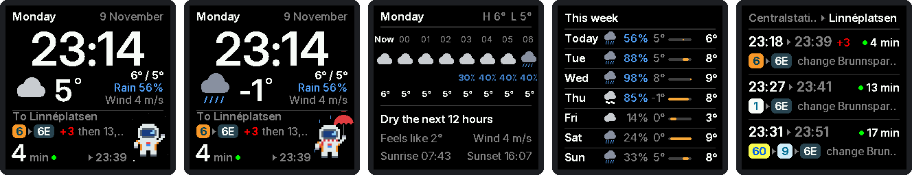
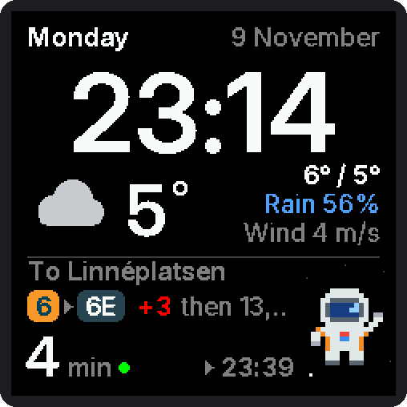
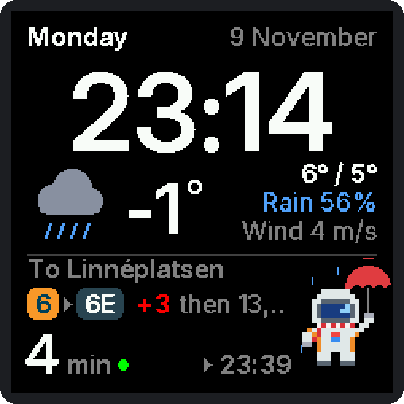
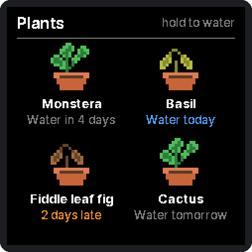

<h1 align="center">small-astro-tv</h1>

<p align="center">A commute clock for the GeekMagic SmallTV Pro: the time, the weather and
the next Västtrafik trip, with a pixel astronaut.</p>

<p align="center">
  
</p>

<p align="center">
  
  
  
</p>

<p align="center"><sub>Rendered from the firmware's own drawing code; stops, trips and plants are examples.</sub></p>

> A fork of [giovi321/smalltv-mod](https://github.com/giovi321/smalltv-mod), which does the
> hard parts: board support, display driver, web UI and WiFi updates. Not affiliated with
> GeekMagic or Västtrafik.

## Screens

Tap the touch button for the next screen. Hold it to go back to Home (on Plants,
holding waters the plants).

| Screen | Shows |
|--------|-------|
| Home   | date, big time, weather now, the quickest trip (lines, delay, minutes, arrival), the astronaut |
| Hours  | the next 8 hours (icon, chance of rain, temperature), rain soon, feels-like, wind and gusts, sunrise to sunset, day length and its weekly change |
| Week   | 7-day forecast |
| Trips  | the next three trips with times and changes |
| Plants | up to four plants that droop as watering falls due |
| Info   | WiFi, IP, firmware, uptime, memory, last fetches |

- **Trips** come from the Västtrafik journey planner, so changes, diversions and
  replacement buses are included. A green dot means a live estimate.
- **Rain soon** uses a 15-minute forecast: "Rain in 25 min", "Stops in 10 min".
  Gusts are shown SMHI style, "Wind 5 (11) m/s", orange from 14 m/s.
- **The astronaut** holds an umbrella in rain, wears a scarf in the cold, waves
  "GO!" when it is time to leave, facepalms at a cancelled trip and sleeps at
  night. Seasonal hats: Santa in December, Lucia on 13 December, flowers on
  Midsummer Eve, a party hat on your birthday.
- **Plants**: hold the button on the Plants screen to water everything due by
  tomorrow. When one is due, Home shows "Water Basil" (or "Water 2 plants") in place of the weekday.
- **Night dimming** in the Display tab, e.g. 19:00 to 08:00.

## Install

You need a GeekMagic SmallTV Pro (classic ESP32, 8 MB, touch button on top).

1. **First install** from the stock firmware: browse to `http://<device-ip>/update`
   and upload `small-astro-tv-firmware-esp32-pro.bin` from
   [Releases](../../releases) or your own build. No cable or opening needed.
2. **WiFi**: on first boot it opens a `SmallTV-Setup` hotspot. Join it, pick your
   2.4 GHz network, save.
3. **Trips**: create an app at [developer.vasttrafik.se](https://developer.vasttrafik.se)
   subscribed to **Planera Resa v4**. In the web UI's Commute tab, paste its
   *Autentiseringsnyckel* and set your two stops (stop area ids start with 9021).
   The key stays on the device; it is never read back or built in.
4. **Location** for the weather: Display tab, "Clock & night mode" card (defaults to Gothenburg).
5. **Plants**: names and how often each wants water, in the Commute tab.
6. Set a web UI password in the System tab.

Upstream's [flashing guide](https://giovi321.github.io/smalltv-mod/getting-started/flashing/)
covers backups and recovery over the UART header.

## Build and update

Requires [PlatformIO](https://platformio.org/).

```bash
cp commute.env.example commute.env   # optional: your stops and birthday as defaults (gitignored)
pio run -e smalltv_esp32_8mb
tools/ota_upload.py <ip> admin <password-file> .pio/build/smalltv_esp32_8mb/firmware.bin
```

`tools/ota_upload.py` sends the password with the upload. Don't use
`curl --digest -F update=@...` on a password-protected device: curl first sends
the image without the password, and that refused upload crashes the device.
Without a password, `curl -F update=@firmware.bin http://<ip>/update` works.

The commute code lives in `src/features/commute/`. Fonts are generated from Inter
by `tools/ttf_to_gfxfont.py`.

## Diagnostics

The device has no log over WiFi; it answers a few JSON endpoints instead. With a
password set, add `--digest -u admin:<password>` to each curl call.

| Endpoint | What it tells you |
|----------|-------------------|
| `GET /api/commute` | current page; last trip fetch (status, HTTP code, time, trips kept); weather age; largest free memory block; touch button readings and presses |
| `POST /api/commute/page` | switch screens: `{"page":n}` or `{"next":true}` (JSON content type) |
| `POST /api/commute/water` | water a plant: `{"plant":i}`, or `{"due":true}` for all due |
| `GET /api/status` | uptime, free heap, WiFi signal, clock sync, why it last restarted |

After a crash the device starts in safe mode with a CRASH screen until new
firmware is uploaded. `reset` in `/api/status` then shows a trace; decode it with
`xtensa-esp32-elf-addr2line -pfiaC -e .pio/build/smalltv_esp32_8mb/firmware.elf <addresses>`.
Full logs need the UART header: `pio device monitor -e smalltv_esp32_8mb`.

## Could go upstream

Fixes that would help smalltv-mod too, not sent yet:

- Buffered TLS reads (`ChunkReader` in `CommuteClient.cpp`): reading a large
  HTTPS reply byte by byte starved the touch button.
- The OTA upload checks the password once per upload (`WebPortal.cpp`); `curl
  --digest` uploads still crash on their first, unauthenticated pass.
- Crash trace on the ESP32 (`src/PanicRecord.cpp`).
- Flicker-free full-screen redraws in RAM strips (`CommuteStrip.h`).

## Credits

- [smalltv-mod](https://github.com/giovi321/smalltv-mod) by giovi321, and the hardware
  notes it builds on.
- Fonts rendered from [Inter](https://rsms.me/inter/) by Rasmus Andersson,
  [SIL Open Font License 1.1](https://openfontlicense.org).
- Weather: [Open-Meteo](https://open-meteo.com). Trips: Västtrafik Planera Resa v4.
- Libraries: [Arduino_GFX](https://github.com/moononournation/Arduino_GFX), [ArduinoJson](https://arduinojson.org/).
- The astronaut and the plants are original pixel art.

The other smalltv-mod features (stock ticker, plane radar, Claude usage meter,
themes, other boards) are still in the code but compiled out of the Pro build;
see [upstream](https://github.com/giovi321/smalltv-mod) for those.

Provided as-is, no warranty; you flash at your own risk.

## License

[WTFPL](LICENSE).
